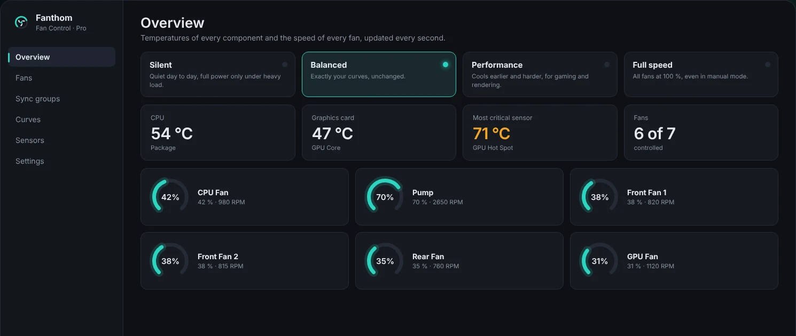

  

<h1 align="center">Fanthom</h1>

  <b>Quiet fans. Full control.</b> 
  A modern fan control app for Windows 10 and 11.

  <a href="https://github.com/fanthom1337-boop/fanthom/releases/latest"><b>Download free</b></a> ·
  <a href="PRO_BUY_URL"><b>Get Pro</b></a> ·
  <a href="https://fanthom1337-boop.github.io/fanthom/">Website</a> ·
  <a href="https://github.com/fanthom1337-boop/fanthom/issues/new/choose">Report a problem</a>

  

## Features

**Free**
- Live overview of every temperature and fan speed, updated every second
- Up to 3 fan curves (Flat, Linear, Graph): drag points on a graph to shape them
- One-click profiles: Silent, Balanced, Performance and Full speed, also from the tray
- Failsafe: if the CPU or GPU core gets too hot, all active fans go to 100 %
- Hands control back to your BIOS when you quit
- English and German interface, no account, no telemetry

**Pro** (one-time €4.99, up to 3 PCs)
- Trigger, Mix and Sync curves
- Unlimited fan curves
- Sync groups: several fans in lockstep from one shared temperature
- Custom sensors: mix, offset, time average, file
- Three extra themes: Nebula, Ember and Arctic

## Installation

1. Install the [.NET 10 Desktop Runtime](https://dotnet.microsoft.com/download/dotnet/10.0) (x64) if you don't have it yet.
2. For motherboard sensors, install the free [PawnIO](https://pawnio.eu) driver.
3. Download the latest `Fanthom-x.y.z-win-x64.zip` from [Releases](https://github.com/fanthom1337-boop/fanthom/releases/latest) and unzip it to a folder of your choice.
4. Start `Fanthom.exe`. It needs administrator rights to access your hardware.
5. On the **Fans** page, enable the fans you want Fanthom to control and pick a curve.

> **Windows shows "unknown publisher"?** Fanthom isn't code-signed yet. Click **More info → Run anyway**.

## Supported hardware

Fanthom uses [LibreHardwareMonitor](https://github.com/LibreHardwareMonitor/LibreHardwareMonitor), so it supports most motherboards from ASUS, MSI, Gigabyte, ASRock and others, NVIDIA and AMD graphics cards and many AIOs. NZXT fan controllers are supported directly.

Not every fan header can be controlled by software. The free version shows exactly which fans are controllable on your PC.

## Fanthom Pro

Buy a license key [here](PRO_BUY_URL), then open Fanthom → **Settings → Fanthom Pro**, paste the key and click **Activate**. To move Pro to another PC, use **Deactivate on this PC** first.

## Problems or ideas?

[Open an issue](https://github.com/fanthom1337-boop/fanthom/issues/new/choose). For hardware problems, please attach a hardware report: **Settings → Diagnostics → Save hardware report** creates a `probe.txt` next to the app.

## About this repository

This repository hosts the Fanthom website, the downloads and the issue tracker. Fanthom itself is closed source. Third-party components and their licenses are listed in [THIRD-PARTY-NOTICES.txt](THIRD-PARTY-NOTICES.txt).

Fanthom is an independent product and is not affiliated with Rémi Mercier's "Fan Control", NZXT or any hardware manufacturer.

[Imprint](https://fanthom1337-boop.github.io/fanthom/imprint.html) · [Privacy](https://fanthom1337-boop.github.io/fanthom/privacy.html) · [EULA](EULA.txt)
